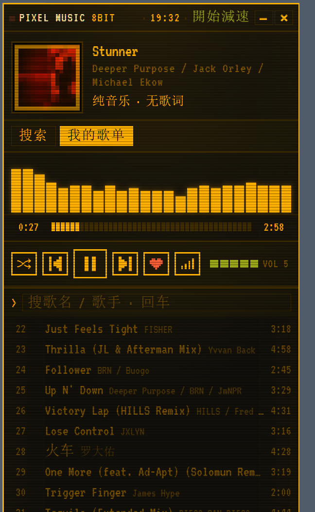

# PIXEL MUSIC 8BIT

把网易云音乐包成一个像素风播放器：8-bit 界面、无边框桌面窗口、歌词、真实频谱、待办面板。

- **不修改网易云客户端**，只读它的接口
- **前端零构建**：一个 `index.html` 就是全部界面，没有框架、没有 bundler
- **外壳原生**：C# WinForms + WebView2，去掉系统标题栏，自绘像素按钮
- 仅供个人学习折腾用，音乐内容版权归网易云音乐所有



---

## 一、直接拿来用

到 [Releases](https://github.com/dtdg7777/sw-pixel-music/releases) 下载 `PIXEL-MUSIC-8BIT.zip`：

1. 解压到**任意可写目录**（桌面、文档都行，**不要放 Program Files**）
2. 双击 `PixelMusic.exe`，等 3~5 秒窗口出现
3. 首次运行 Windows 会提示「已保护你的电脑」→ 更多信息 → 仍要运行（未签名）

需要：Windows 10/11 x64 + 系统自带的 WebView2（装了 Edge 一般就有）。

---

## 二、跑起来开发

### 环境

| 需要 | 说明 |
|---|---|
| Node.js 18+ | 跑本地代理服务 |
| 浏览器 | 调试页面用 |
| .NET Framework 4.x | **只有重新编译外壳才需要**，Win10/11 自带的 csc.exe 就够，不用装 .NET SDK |

### 第一次跑

```bash
npm install          # 装 NeteaseCloudMusicApi
node server.js       # 起本地服务（只绑 127.0.0.1:8123）
```

然后浏览器打开 http://127.0.0.1:8123 —— 这就是完整的播放器界面，改 `index.html` 刷新即可。

也可以用 `node launcher.js`：它会起服务并开一个 Edge 应用窗口，比浏览器标签页更像成品。

### 登录

界面上点右上角昵称 → 扫码登录，cookie 会写进 `.cookie.txt`（已 gitignore）。

**这个文件绝对不能提交**，它等于你的网易云账号。

---

## 三、架构

```
┌──────────────────────────┐
│ index.html（唯一前端文件） │  无框架、无构建，状态全在全局变量里
└────────────┬─────────────┘
             │ fetch 同源请求
┌────────────▼─────────────┐
│ server.js（本地 Node 代理）│  静态托管 + 接口转发 + cookie 托管
└────────────┬─────────────┘
             │
┌────────────▼─────────────┐
│ NeteaseCloudMusicApi      │  社区维护的接口封装
└──────────────────────────┘
```

**为什么必须有这层代理**：网易云接口不允许跨域直连，还要求特定 Referer 和登录 cookie。
更要紧的是音频流 —— 直接引用 `music.126.net` 的地址会跨域，接不上 `createMediaElementSource`，
频谱就只能是假动画。走同源 `/stream` 代理之后 Web Audio API 才拿得到真实 FFT 数据。

---

## 四、目录

```
index.html              整个 UI（HTML + CSS + JS 全在一个文件里）
server.js               本地代理：静态资源 + 接口 + 音频流
launcher.js             便捷启动：起服务 + 开 Edge app 窗口
PIXEL MUSIC.vbs         双击启动的包装（不弹黑框）
assets/                 图标、VT323 字体、PWA 用的图片
shell/                  C# 外壳源码 + 预编译的 PixelMusic.exe
  Program.cs            WinForms 主窗体：无边框、拖拽、缩放、WebView2 托管
  app.manifest          PerMonitorV2 DPI 声明
tools/make-icon.js      从零生成 ico/png（手写 PNG 编码，不依赖图形库）
```

---

## 五、服务端接口

全部只监听 127.0.0.1，前端同源调用，所以没有 CORS 问题。

| 路由 | 作用 | 备注 |
|---|---|---|
| `/api/status` | 登录态 + 昵称 | |
| `/api/search?q=&limit=` | 搜歌 | cloudsearch |
| `/api/url?id=&level=` | 取音源地址 | level 白名单：standard / higher / exhigh / lossless / hires |
| `/stream?id=&level=` | **音频流代理** | 支持 Range，频谱靠它 |
| `/api/lyric?id=` | 歌词 | 返回 LRC 原文 |
| `/api/playlists` | 我的歌单 | |
| `/api/playlist?id=` | 歌单曲目 | |
| `/api/like?id=&like=1` | 红心 / 取消 | 需要登录 |
| `/api/likelist` | 我喜欢的 id 列表 | 需要登录 |
| `/api/scrobble?id=&time=&sourceid=` | 播放上报 | 影响网易云推荐与听歌排行 |
| `/api/qr/key` `/api/qr/create` `/api/qr/check` | 扫码登录三步 | check 返回 803 时落 cookie |
| `/api/logout` | 退出（不清本地数据） | |
| `/img?u=` | 封面图代理 | 只放行 music.126.net 等域名 |

---

## 六、想加功能

### 加一个新接口（三步）

1. `server.js` 里加一条路由，转调 NeteaseCloudMusicApi 的对应方法
2. `index.html` 里 fetch 它
3. 页面状态更新 + `msg()` 给个反馈

### 前端状态都在哪

| 变量 | 含义 |
|---|---|
| `list` / `cur` | 当前列表 / 当前索引 |
| `mode` | list / one / shuffle（播放模式） |
| `level` / `levelShown` | 请求的音质 / 实际拿到的音质 |
| `liked` | 红心 id 集合 |
| `scrobbled` | 已上报记录（`id:播放序号` 去重） |

持久化用 localStorage：`pmp.mode`、`pmp.level`、`pmp.todo.v1`。
桌面壳里它们落在 `shell/wv2-data`，删掉那个目录等于清空所有本地状态。

界面上那些像素图标（心形、信号条）是 **2×2 元素 + box-shadow 铺格子**画的，不是图片 ——
想改形状就改 shadow 列表，想改颜色就改 `currentColor`。

---

## 七、重新编译外壳

Win10/11 自带 .NET Framework 的 csc.exe，不需要装 SDK：

```batch
cd shell
csc -nologo -target:winexe -platform:x64 ^
    -win32manifest:app.manifest -win32icon:../assets/app.ico ^
    -out:PixelMusic.exe ^
    -r:Microsoft.Web.WebView2.Core.dll -r:Microsoft.Web.WebView2.WinForms.dll ^
    -r:System.Windows.Forms.dll -r:System.Drawing.dll Program.cs
```

> 在 MSYS bash / Git Bash 里要写 `-r:` 而不是 `/r:` —— 后者会被路径转换成盘符路径。

---

## 八、踩过的坑（照着绕）

1. **端口被占 ≠ 服务活着**
   关旧实例时它的 server 还在退出，新实例探到端口有人听就不启自己的服务，于是窗口开着、后端死了。
   现在壳里有 5 秒看门狗，端口没人听就把服务拉起来。

2. **WebView2 被遮挡会停止渲染 → 黑窗**
   窗口被完全盖住再切回来可能一片黑（进程没崩、页面照样 200）。启动参数已禁用
   `CalculateNativeWinOcclusion` 等后台化特性，并在窗口激活时强制重绘。

3. **WinForms 会二次折算窗口尺寸**
   `Bounds` 会被 DPI 再缩放一次。必须 `AutoScaleMode.None` + 运行时 `SetWindowPos`，
   按 `GetDpiForWindow` 算物理尺寸，页面视口才能稳定是 430×700 CSS 像素。

4. **WebView2 默认拦非手势 play()**
   我们的 play() 在 fetch 回调里调用，不在点击手势栈内，会被拒（表现是「播放键要点两次」）。
   启动参数加 `--autoplay-policy=no-user-gesture-required`。

5. **临时目录不可写会让接口库直接崩**
   NeteaseCloudMusicApi 启动时往 `os.tmpdir()` 写 anonymous_token，某些环境 EPERM。
   壳里把子进程的 TMP/TEMP 指到应用自己的 `tmp/` 目录。

6. **PowerShell 5.1 按 ANSI 读 .ps1**
   带中文注释的脚本必须存成 UTF-8 **with BOM**，否则解析就报错。

7. **Get-Content 默认也是 ANSI**
   读 UTF-8 无 BOM 的文件会乱码 —— 乱码通常不是文件坏了，是读法不对。

---

## 九、贡献

fork 之后直接改 `index.html` / `server.js` 就行，没有构建步骤。提交前请确认：

- `.cookie.txt`、`node_modules/`、`dist/`、`shell/wv2-data/` 没有进 commit
- `node --check server.js` 和页面脚本语法都过
- 如果动了外壳，把重新编译的 `PixelMusic.exe` 一起提交（朋友不想为这个装编译器）

## 十、声明

代码 MIT。音乐、歌词、封面等内容的版权归网易云音乐及其权利人所有，
本项目只是个人学习用的客户端外壳，不提供任何内容的下载与再分发。
